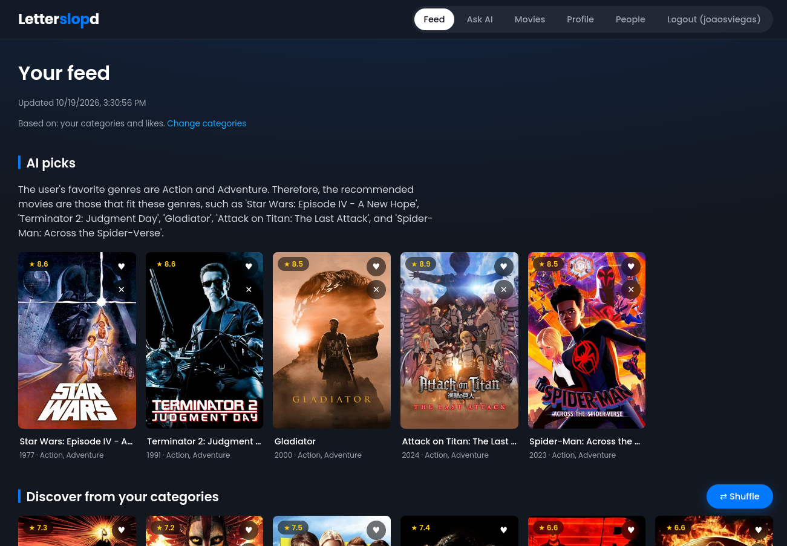
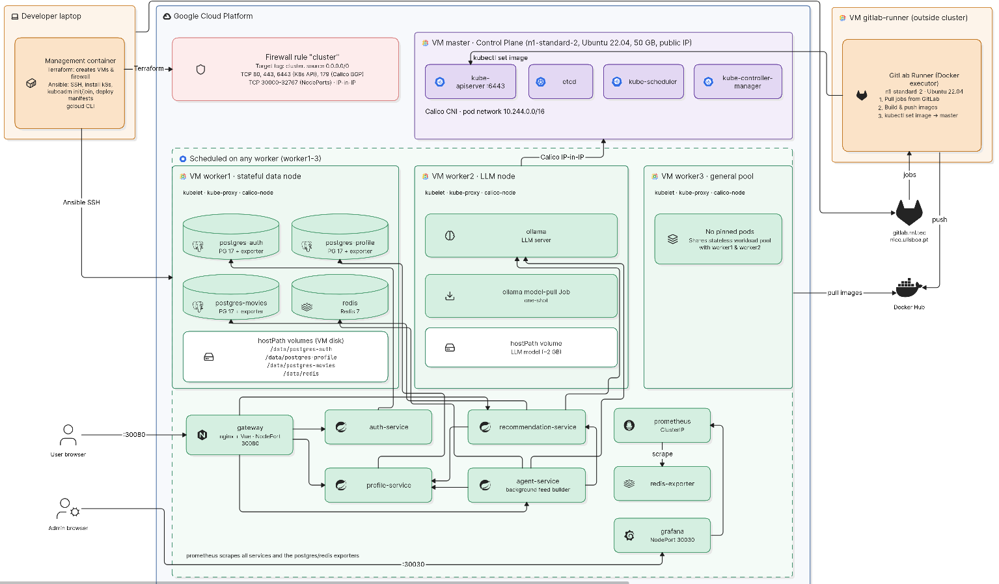

# PSIA - AI Movie Recommendation Hub (group 37)

Microservices app for the Platforms for AI Systems project: register, build a movie profile, browse other users,
ask an LLM for recommendations, and get a feed pre-computed by a background agent.



## Prerequisites

- **Docker** (Desktop on macOS/Windows with >= 8 GB memory; on Windows use WSL2)
- **[just](https://github.com/casey/just)** — command runner (like make but simpler)
- **git**, **curl** (used by `scripts/smoke.sh`)

A JDK is **not** required. Maven builds run inside Docker containers.

## Quick start

```bash
# 1. Clone and configure
git clone <repo-url> && cd g37
cp .env.example .env
# Edit .env: change every password and set JWT_SECRET to a random 32+ char string.

# 2. Start everything (movie catalog loads automatically on first startup)
just start          # builds all images and pulls the LLM model (~1 GB, first run only)
just ps             # wait until every service shows "healthy"

# 3. Open the app
open http://localhost:8080    # or just visit it in a browser

# 4. Verify
just smoke          # runs end-to-end checks through the gateway
```

The movie catalog (~7k enriched movies with posters, overviews, directors and
cast) is bundled in the Docker image and loaded into Postgres automatically on
first startup. No external downloads or scripts needed.

## Commands

| Command | What it does |
|---|---|
| `just start` | Build images, start all containers |
| `just stop` | Stop containers (data volumes kept) |
| `just ps` | Container status and health |
| `just logs <service>` | Follow logs (omit service for all) |
| `just smoke` | End-to-end test through the gateway |
| `just clean` | Stop and delete Postgres + Redis data (keeps the LLM model) |
| `just nuke` | Stop and delete EVERYTHING including the LLM model |

## Services



| Service | Path via gateway | Store |
|---|---|---|
| gateway (nginx + Vue) | `/` | — |
| auth-service | `/api/auth/*` | Postgres server `postgres-auth` |
| profile-service | `/api/profiles/*` | Postgres server `postgres-profile` |
| recommendation-service | `/api/movies/*`, `/api/recommendations` | Postgres server `postgres-movies` + Ollama |
| agent-service | `/api/feed/*` | Redis + Ollama |
| llm (Ollama) | internal | model volume |
| prometheus | `http://localhost:9090` | metrics volume |
| grafana | `http://localhost:3000` | dashboards volume |
| postgres-{auth,profile,movies}-exporter, redis-exporter | internal | — |

recommendation-service covers movie search/browse (`GET /api/movies`) and
the "Ask AI" recommendation flow (`POST /api/recommendations`): pick some
genres and a mood, and it asks the LLM to pick from a genre-matched pool of
IMDb movies pulled from Postgres, falling back to a plain top-rated list if
the LLM is unavailable.

agent-service builds each user's feed in the background. Every
`AGENT_INTERVAL_SECONDS` it fetches profiles changed since its last run (plus
users whose feed was requested but missing), asks the LLM to pick movies from
their favourite genres (skipping ones they already liked/disliked), adds movies
liked by similar users, and stores the result in Redis for `FEED_TTL_HOURS`.
`GET /api/feed` returns the stored feed, or `202 {"status":"pending"}` and
queues the user for the next run.

## Monitoring

`just start` also brings up the monitoring stack:

- **Prometheus** (`http://localhost:9090`) scrapes every 15s: `/actuator/prometheus` on the four
  Spring services, the three Postgres exporters and `redis-exporter`. Config: `infra/monitoring/prometheus/prometheus.yml`.
- **Grafana** (`http://localhost:3000`, user `admin`, password `GRAFANA_ADMIN_PASSWORD` from `.env`)
  opens on the provisioned **PSIA Movie Hub** dashboard (`infra/monitoring/grafana/`).

## GCP Cloud Deployment (Kubernetes)

Everything lives under `gcpcloud/`. A Docker-based management container
(Dockerfile + supervisord) ships terraform, ansible, gcloud, and kubectl so
you don't need any of those installed locally.

### Prerequisites

- A GCP project with billing enabled and the Compute Engine API active.
- A GCP service account JSON key (`gcpcloud/YOUR-GCP-KEY.json`).
  Download it from GCP Console → IAM → Service Accounts → Create Key (JSON).
- A Docker Hub account with the project images pushed (see **Push images** below).

### 1. Configure

Edit `gcpcloud/terraform-gcp-variables.tf`:
```hcl
variable "GCP_PROJECT_ID" { default = "your-gcp-project-id" }
variable "GCP_MACHINE_TYPE" { default = "n1-standard-2" }  # 7.5 GB RAM — needed for Ollama
variable "GCP_ZONE" { default = "europe-west1-c" }          # change if zone is out of capacity
```

Edit `gcpcloud/terraform-gcp-provider.tf` — replace the credentials filename:
```hcl
credentials = file("YOUR-GCP-KEY.json")   # must match the file you placed in gcpcloud/
```

### 2. Push images to Docker Hub

Once the CI/CD pipeline is set up, its `build` stage does this on every push and you can skip this step.
Otherwise, before provisioning, build and push all service images so the K8s nodes can pull them:

```bash
# from repo root — build and tag each image
docker build -t <DOCKER_HUB_USER>/g37-auth-service           services/auth-service
docker build -t <DOCKER_HUB_USER>/g37-profile-service        services/profile-service
docker build -t <DOCKER_HUB_USER>/g37-recommendation-service services/recommendation-service
docker build -t <DOCKER_HUB_USER>/g37-agent-service          services/agent-service
docker build -t <DOCKER_HUB_USER>/g37-gateway                frontend

docker push <DOCKER_HUB_USER>/g37-auth-service
docker push <DOCKER_HUB_USER>/g37-profile-service
docker push <DOCKER_HUB_USER>/g37-recommendation-service
docker push <DOCKER_HUB_USER>/g37-agent-service
docker push <DOCKER_HUB_USER>/g37-gateway
```

### 3. Start the management container

```bash
cd gcpcloud
just start   # builds the mgmt image and runs the container
just mgmt    # opens a shell inside it
```

All following commands run **inside the mgmt container** unless noted otherwise.

### 4. Authenticate with GCP

```bash
gcloud auth login       # follow the browser link and paste the verification code
```

### 5. Generate an SSH key (first time only)

```bash
ssh-keygen -t rsa -b 2048   # press ENTER to all prompts — no passphrase
```

### 6. Provision infrastructure with Terraform

```bash
cd project/gcpcloud
terraform init
terraform plan
terraform apply
```

Terraform creates 1 master + 3 worker VMs (`n1-standard-2`, Ubuntu 22.04),
a firewall rule that opens ports 80, 443, 6443 (K8s API), 179 (Calico BGP),
and the NodePort range 30000–32767, and the GitLab CI runner VM
(see **Advanced Component: CI/CD Pipeline**, which needs `gcpcloud/runner.auto.tfvars`
to exist before `terraform apply`). To provision only the cluster, without the runner:
`terraform apply -target=google_compute_instance.master -target=google_compute_instance.worker -target=google_compute_firewall.cluster_rules`.

The final output lists the public IPs:
```
master    = <master-ip>
worker_IPs = ["worker1 = <ip1>", "worker2 = <ip2>", "worker3 = <ip3>"]
```

If you get a zone capacity error, change `GCP_ZONE` (e.g. `europe-west1-b`) and re-apply.

### 7. Fill in the Ansible inventory and /etc/hosts

Take the IPs from the terraform output and do **both** of the following.

**On the host** — edit `gcpcloud/gcphosts`:
```
master    ansible_host=<master-ip>  ansible_user=ubuntu ansible_connection=ssh
worker1   ansible_host=<ip1>        ansible_user=ubuntu ansible_connection=ssh
worker2   ansible_host=<ip2>        ansible_user=ubuntu ansible_connection=ssh
worker3   ansible_host=<ip3>        ansible_user=ubuntu ansible_connection=ssh
```

**Inside the mgmt container** — add entries to `/etc/hosts` so hostnames resolve:
```bash
# run these inside the container (just mgmt)
echo "<master-ip>  master"  >> /etc/hosts
echo "<ip1>        worker1" >> /etc/hosts
echo "<ip2>        worker2" >> /etc/hosts
echo "<ip3>        worker3" >> /etc/hosts
```

Because `gcphosts` is mounted from the host (`/root/project/gcpcloud/gcphosts`),
editing it on the host is enough for ansible. The `/etc/hosts` change is only
needed for the container session and must be repeated if you restart the container.

### 8. Ansible playbooks 

| Playbook | What it does |
|---|---|
| `ansible-gcp-configure-nodes.yml` | Sudoers + base packages on all nodes |
| `ansible-k8s-install.yml` | containerd, kubelet, kubeadm, kubectl (v1.28) on all nodes |
| `ansible-create-cluster.yml` | `kubeadm init` on master, Calico CNI, save join command |
| `ansible-workers-join.yml` | Workers join the cluster using the saved join command |
| `ansible-deploy-app.yml` | Apply K8s manifests for all project services |

Run them in order from inside the mgmt container:
```bash
cd /root/project/gcpcloud
ansible-playbook ansible-gcp-configure-nodes.yml
ansible-playbook ansible-k8s-install.yml
ansible-playbook ansible-create-cluster.yml
ansible-playbook ansible-workers-join.yml
ansible-playbook ansible-deploy-app.yml -e docker_hub_user=<DOCKER_HUB_USER>
```

Verify the cluster on the master:
```bash
# ssh into master (see GCP Console > Compute Engine > VM instances > master > SSH)
sudo kubectl get nodes   # all 4 nodes should show Ready
sudo kubectl get pods -A # all app pods should show Running
```

### 9. K8s manifests

All manifests live in `gcpcloud/k8s/` and are applied by `ansible-deploy-app.yml`.

**Before applying — set your secrets and image names:**

1. Edit `gcpcloud/k8s/00-secret.yaml` — replace all `change_me_*` values (same as `.env`).
2. Pass the Docker Hub user that owns the images as `-e docker_hub_user=<DOCKER_HUB_USER>`.
   The playbook replaces the `DOCKER_HUB_USER` placeholder in manifests `04` through `08` with it.

| File | What it creates |
|---|---|
| `00-secret.yaml` | Secret with all passwords and JWT_SECRET |
| `01-postgres.yaml` | One Postgres server per service (`postgres-auth`, `-profile`, `-movies`): hostPath on worker1 + Deployment with exporter sidecar + ClusterIP Service |
| `02-redis.yaml` | hostPath on worker1 + Deployment + ClusterIP Service |
| `03-ollama.yaml` | hostPath on worker2 + Deployment + ClusterIP Service + pull Job |
| `04-auth-service.yaml` | Deployment + ClusterIP Service |
| `05-profile-service.yaml` | Deployment + ClusterIP Service |
| `06-recommendation-service.yaml` | Deployment + ClusterIP Service |
| `07-agent-service.yaml` | Deployment + ClusterIP Service |
| `08-gateway.yaml` | Deployment + NodePort Service (port **30080**) |
| `09-monitoring.yaml` | Prometheus + Redis exporter (ClusterIP) + Grafana (NodePort 30030). Config comes from `infra/monitoring/` via the `monitoring-config` ConfigMap created by `ansible-deploy-app.yml` |

**After applying — pull the Ollama model:**

The `ollama-pull` Job (in `03-ollama.yaml`) runs automatically but needs the Ollama pod to be up first. Watch its progress:
```bash
# on master
sudo kubectl get pods -w         # wait for ollama-* pod to be Running
sudo kubectl logs job/ollama-pull -f  # watch the model download (~1 GB)
```

Open the app at `http://<any-worker-ip>:30080` once all pods are Running.

### 10. Teardown

```bash
# from inside mgmt container
terraform destroy
```

Check the GCP Console to confirm all VMs are gone, **leaving VMs running costs money**.

Then exit the container and stop it:
```bash
# from the host, in gcpcloud/
just stop
```

## Advanced Component: CI/CD Pipeline

Every push runs a GitLab CI pipeline (`.gitlab-ci.yml`) on a self-hosted runner in GCP. The pipeline
tests and packages the application, and on `master` it also deploys it to the Kubernetes cluster.

```
test ──► e2e ──► build ──► deploy (master only)
```

| Stage | Jobs | What it does |
|---|---|---|
| `test` | `test:<service>` × 4 | `mvn test` for each Spring service, in parallel. JUnit reports show up in the GitLab MR/pipeline UI |
| `e2e` | `e2e_tests` | Starts the full stack with `docker compose` (without the LLM model, so the AI paths use their fallback) and runs the Playwright suite in `frontend/tests/e2e/`. The HTML report, traces and videos are kept as job artifacts for 7 days |
| `build` | `build:<service>` × 5 | Builds the 4 service images + the gateway and pushes `<DOCKER_HUB_USER>/g37-<svc>:<commit-sha>` and `:latest` to Docker Hub, so only images that passed e2e are published |
| `deploy` | `deploy:k8s` | SSHes into the cluster master and runs `kubectl set image` to roll every service to the image built from this commit, then waits for `kubectl rollout status` |

The deploy updates images only. Manifest changes (new env vars, new services, secrets) are still
applied with `ansible-playbook ansible-deploy-app.yml`. Because every deploy uses an immutable
commit-SHA tag, rolling back is `sudo kubectl rollout undo deployment/<svc>` on the master.

### Running the same tests locally

```bash
just test auth-service   # unit/integration tests for one service (also: profile-service, recommendation-service, agent-service)
just start && just test-e2e   # Playwright E2E against the local Docker stack
```

### 1. GitLab runner on GCP

The runner is a separate VM (`gcpcloud/terraform-gcp-runner.tf`), not part of the K8s cluster, so CI keeps
working while the cluster is torn down or rebuilt. It is an `n1-standard-2` with the **Docker executor**. The host's
Docker socket is mounted into jobs because the build and e2e stages run `docker build` / `docker compose`.
`concurrent = 2` so two Maven jobs fit in 7.5 GB of RAM.

1. In GitLab: **Settings → CI/CD → Runners → New project runner**. Platform **Linux**, tick **Run untagged jobs**
   (the pipeline jobs have no `tags:`). Copy the `glrt-...` token.
2. Put the token in `gcpcloud/runner.auto.tfvars` (gitignored, never commit it):
   ```hcl
   GITLAB_RUNNER_TOKEN = "glrt-..."
   ```
3. From the mgmt container:
   ```bash
   cd /root/project/gcpcloud
   terraform apply -target=google_compute_instance.gitlab_runner   # runner only
   ```
   The VM's startup script installs Docker and `gitlab-runner` and registers against
   `https://gitlab.rnl.tecnico.ulisboa.pt`. Allow about 2 minutes.
4. Check it: the runner shows a green dot under **Settings → CI/CD → Runners**. On the VM
   (`ssh ubuntu@$(terraform output -raw gitlab_runner_ip)`):
   ```bash
   sudo gitlab-runner verify          # "is valid"
   sudo systemctl status gitlab-runner
   sudo journalctl -u google-startup-scripts --no-pager | tail -50   # if it didn't register
   ```

If the token is lost or revoked, create a new runner in GitLab, update `runner.auto.tfvars`, and run
`terraform apply -replace=google_compute_instance.gitlab_runner`.

### 2. CI/CD variables

**Settings → CI/CD → Variables**. `master` must be a protected branch (GitLab's default) so protected variables reach it.

| Key | Value | Settings |
|---|---|---|
| `DOCKER_HUB_USER` | Docker Hub username (same as `docker_hub_user` passed to `ansible-deploy-app.yml`) | Visible |
| `DOCKER_HUB_TOKEN` | Docker Hub access token (Account settings → Personal access tokens, Read & Write) | Masked and hidden, Protected |
| `K8S_SSH_KEY` | Private key the VMs trust, base64 on one line: `base64 -w0 /root/.ssh/id_rsa` in the mgmt container | Type Variable, Masked and hidden, Protected, Expand off |
| `K8S_MASTER_IP` | `terraform output master` | Visible |

`K8S_SSH_KEY` is base64-encoded because GitLab refuses to mask values that contain whitespace. The job decodes it.
Uses the private key (`id_rsa`).

### 3. Turning auto-deploy on and off

`deploy:k8s` only runs when the branch is `master` **and** `K8S_MASTER_IP` is set:

- **Cluster up:** set `K8S_MASTER_IP` to the current master IP. It changes every time the cluster VMs are recreated.
- **Cluster destroyed:** delete `K8S_MASTER_IP`. The deploy job then doesn't appear and the pipeline stays green.

### 4. Verifying a deploy

1. Push a commit to `master` and watch `test → e2e → build → deploy` finish in **Build → Pipelines**.
2. On the master: `sudo kubectl get deploy -o wide` shows images tagged with the pipeline's short commit SHA.
3. Open `http://<any-worker-ip>:30080`.

### Cost

The runner VM runs all the time (about the same price as one cluster node). Stop it from GCP Console →
Compute Engine when it isn't needed, or remove it with
`terraform destroy -target=google_compute_instance.gitlab_runner`.

## Team

| Member | Owns |
|---|---|
| _João Sérgio Viegas_ | auth-service, profile-service, frontend: auth/profile/browse pages |
| _Diogo Lobo_ | recommendation-service, dataset, frontend: movie search + "Ask AI" page |
| _Miguel Silva_ | agent-service, frontend shell + feed page, compose/justfile integration |
